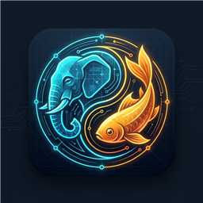
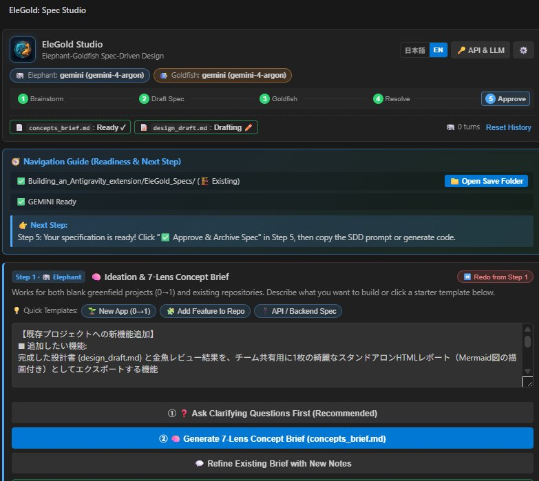
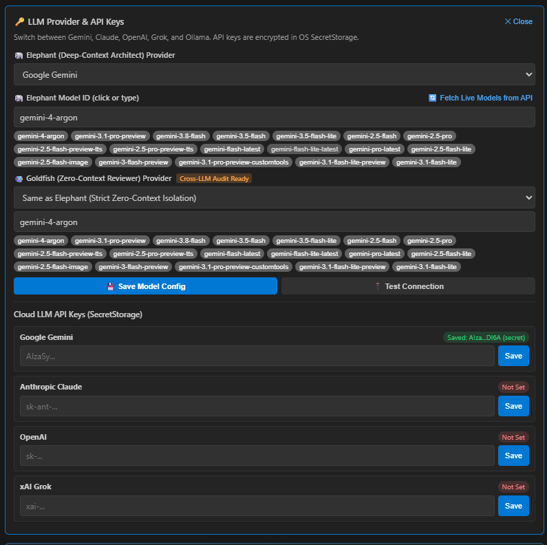
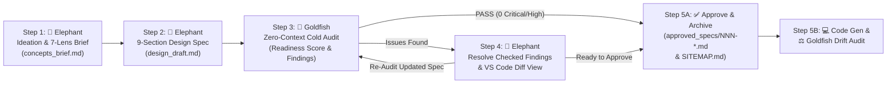

# 🐘🐠 EleGold Studio — Elephant-Goldfish Specification-Driven Design (SDD)

<p align="center">
  
</p>

<p align="center">
  <a href="https://github.com/koba4061/antigravity-egm-studio-ext/raw/main/antigravity-egm-studio-ext-0.3.0.vsix"></a>
</p>

<p align="center">
  <a href="https://github.com/google/elephant-goldfish-model"></a>
  <a href="./LICENSE.txt"></a>
  
</p>

> ### 📦 Direct `.vsix` Download (1-Click Ready to Install)
> - **👉 [Click here to directly download `antigravity-egm-studio-ext-0.3.0.vsix`](https://github.com/koba4061/antigravity-egm-studio-ext/raw/main/antigravity-egm-studio-ext-0.3.0.vsix)**
> - **How to Install (30 seconds)**: Open **VS Code / Antigravity / Cursor / Windsurf** → Press `Ctrl+Shift+P` (`Cmd+Shift+P` on macOS) → Run **`Extensions: Install from VSIX...`** → Select the downloaded `antigravity-egm-studio-ext-0.3.0.vsix`.

**EleGold Studio** is a Specification-Driven Development (SDD) extension for **VS Code**, **Antigravity IDE**, **Cursor**, **Windsurf**, and all VS Code-compatible editors, built on Google's **[Elephant-Goldfish Model (`google/elephant-goldfish-model`)](https://github.com/google/elephant-goldfish-model)**.

Instead of jumping straight into premature code generation, EleGold Studio enforces a disciplined **"Design with an Elephant, Review with a Goldfish"** workflow so you can lock down a rock-solid, zero-ambiguity engineering specification before writing a single line of application code.

---

## 📸 Screenshots & Visual Workflow

<p align="center">
  
</p>
<p align="center">
  <em>5-Step Specification Studio with real-time readiness navigation, bilingual switcher (<code>EN</code> / <code>日本語</code>), and one-click artifact viewers.</em>
</p>

<p align="center">
  
</p>
<p align="center">
  <em>Independent provider & model selection for <strong>🐘 Elephant (Architect)</strong> and <strong>🐠 Goldfish (Zero-Context Reviewer)</strong> with encrypted OS SecretStorage.</em>
</p>



---

## 🔗 Upstream Relationship with [`google/elephant-goldfish-model`](https://github.com/google/elephant-goldfish-model)

Google's upstream **[`google/elephant-goldfish-model`](https://github.com/google/elephant-goldfish-model)** defines the core methodology and CLI skill prompts for separating **deep-context specification drafting (🐘 Elephant)** from **zero-context adversarial auditing (🐠 Goldfish)**.

**EleGold Studio** brings that methodology into a full **5-Step Visual IDE Studio** with multi-provider API support (Gemini, Claude, OpenAI, Grok, Ollama), native Prompt Caching, persistent state management, and one-click HTML rendering:

| Upstream [`google/elephant-goldfish-model`](https://github.com/google/elephant-goldfish-model) Skill / Artifact | EleGold Studio GUI Equivalent |
| :--- | :--- |
| **`/egm-brainstorm`** (Problem Drilling + 7-Lens Shootdown → `concepts_brief.md`) | **Step 1**: Interactive multiple-choice Clarifying Interview + 7-Lens Concept Brief generator (`EleGold_Specs/concepts_brief.md`) |
| **`/egm-draft`** (9-Section Zero-Guesswork Engineering Spec → `design_draft.md`) | **Step 2**: Formal 9-Section Design Specification generator with CUJs, Mermaid diagrams & interface contracts (`EleGold_Specs/design_draft.md`) |
| **`/egm-review`** (Stages 5–9 Cold Goldfish Swarm + Stage 6 Comprehension Paraphrase) | **Step 3**: Isolated Zero-Context Goldfish Auditor with Comprehension Paraphrase, Readiness Score (`0–100%`), and selectable rubric lenses (`EleGold_Specs/goldfish_review_report.md`) |
| **`/egm-resolve`** (Section 9 Resolution Log + Author Deferrals) | **Step 4**: Interactive checkbox resolution, automatic `Deferred by author` logging, and side-by-side VS Code Diff View |
| **Canonical Archival (`designs/NNN-*.md` & `SITEMAP.md`) + `/egm-drift-report`** | **Step 5**: One-click Spec Approval (`EleGold_Specs/approved_specs/NNN-*.md` & `SITEMAP.md`), SDD Code Generation, and Goldfish Drift Auditor (`drift_report.md`) |

---

## ✨ Key Features

- **🐘🐠 Strict Context Isolation (Elephant vs. Goldfish)**
  - **🐘 Elephant (Architect)**: Retains full project context, conversation history (`.egm/elephant_context.json`), web research references (`.egm/web_research.json`), `concepts_brief.md`, and `design_draft.md`.
  - **🐠 Goldfish (Zero-Context Auditor)**: Audits `design_draft.md` cold in a fresh, isolated session with **zero access** to prior chat history, `concepts_brief.md`, or author excuses.
- **🔒 Strict 5-Step Prerequisite Gatekeeping & Iterative Review Loop**
  - Enforces step-by-step progression (`Step 1` → `Step 2` → `Step 3 ⇄ Step 4 Iterative Loop` → `Step 5A Approval` → `Step 5B Implementation & Drift Audit`). Downstream actions remain safely locked until upstream prerequisites are satisfied.
- **⚡ Native Multi-Provider Prompt Caching + Local SHA-256 Cache**
  - Front-loads static context blocks (`cacheableContext`) and leverages official provider caching mechanisms to cut input token costs by **50%–90%** (and **100%** on identical local cache hits):
    - **Google Gemini**: Prefix-first message structure for **Implicit Context Caching** (`usageMetadata.cachedContentTokenCount`).
    - **Anthropic Claude**: Explicit `cache_control: { type: "ephemeral" }` breakpoints on system instructions and reference specifications (`usage.cache_read_input_tokens`).
    - **OpenAI**: Prefix-first ordering + `prompt_cache_key` sticky routing (`usage.prompt_tokens_details.cached_tokens`).
    - **xAI Grok**: Prefix-first ordering + `x-grok-conv-id` sticky server routing header.
    - **Ollama (Local)**: `keep_alive: "30m"` to keep model weights and `llama.cpp` KV cache warm in VRAM (`prompt_eval_cached_count`).
    - **Local SHA-256 Response Cache**: Instant 0ms, zero-cost retrieval for identical requests within 24 hours.
- **👁️ One-Click Standalone HTML Specification Viewer**
  - Renders any Markdown artifact (`concepts_brief.md`, `design_draft.md`, `goldfish_review_report.md`, `drift_report.md`, `implementation_output.md`) as a clean, self-contained HTML report with table of contents, syntax highlighting, Mermaid diagram rendering, and dark/light theme toggle.
- **💾 Full State Persistence Across IDE Reloads**
  - Automatically persists all user inputs, clarifying question wizard progress, selected audit lenses, individual review finding checkboxes, and review round status in `EleGold_Specs/.egm/`.
- **🌐 Complete Bilingual Support (`EN` ⇄ `日本語`)**
  - Switch between English and Japanese at any time from the top header. In `EN` mode, both the UI and 100% of generated LLM artifacts are produced strictly in English.

---

## 🌟 Core Architecture: Strict Context Separation

| Role | Context Provided | Context Excluded | Responsibility |
| :--- | :--- | :--- | :--- |
| **🐘 Elephant (Architect)** | • Workspace file tree & `package.json`<br>• Full conversation history (`.egm/elephant_context.json`)<br>• Web research references (`.egm/web_research.json`)<br>• `concepts_brief.md` & `design_draft.md` | None (Retains full memory) | Drills into requirements, runs 7-lens trade-off analysis (`concepts_brief.md`), and drafts/revises the 9-section engineering specification (`design_draft.md`). Writes zero premature implementation code during design. |
| **🐠 Goldfish (Auditor)** | • Target specification (`design_draft.md`)<br>• Read-only codebase structure for fit checks | **• All Elephant chat history**<br>• `concepts_brief.md` & author excuses | Audits the specification cold in a fresh, zero-context session. Performs a **Stage 6 Comprehension Paraphrase Test**, calculates a **Readiness Score (0–100%)**, and flags unstated assumptions, edge cases, security flaws, and ambiguities. |
| **👤 You (Lead Engineer)** | • 5-Step Sidebar GUI, HTML Viewer & VS Code Diff View | Manual prompt copy-pasting | Steer architectural trade-offs, select which Goldfish findings to resolve via checkboxes, and approve the final spec. |

---

## 🚀 The 5-Step EGM Workflow (`EleGold_Specs/`)

All generated specifications and internal state files are stored neatly inside `<your-project>/EleGold_Specs/` so your repository root stays clean:

1. **Step 1: 🧠 Ideation & 7-Lens Concept Brief (`EleGold_Specs/concepts_brief.md`)**
   - Run an interactive multiple-choice clarifying interview (`No Glazing` stress-test) and synthesize requirements across the **7 Official EGM Lenses**:
     1. *Contrarian / YAGNI*
     2. *Cost, Quota & Resource Economics*
     3. *UX & Developer Ergonomics*
     4. *Migration & Backward Compatibility*
     5. *Observability & SRE Debuggability*
     6. *Long-Term Tech Debt*
     7. *Inventive Catalyst*
2. **Step 2: 📝 Draft 9-Section Design Specification (`EleGold_Specs/design_draft.md`)**
   - Generates a zero-guesswork engineering specification containing:
     1. *Overview & The Problem*
     2. *Goals & Non-Goals*
     3. *Critical User Journeys (CUJs in `Given / When / Then`)*
     4. *Technical Plan & Data Flow (with Mermaid diagrams)*
     5. *Alternatives Considered (`Rejected by author` rationale)*
     6. *Error Handling, Edge Cases & Non-Functional Requirements*
     7. *Detailed Implementation Plan (Target Files & Concrete Interfaces)*
     8. *Verification & Test Plan*
     9. *Design Decisions, Brief Reconciliation & Goldfish Review Log*
3. **Step 3: 🔍 Fresh Zero-Context Goldfish Review (`EleGold_Specs/goldfish_review_report.md`)**
   - Goldfish reads `design_draft.md` cold, writes a **Stage 6 Comprehension Paraphrase**, scores implementation readiness (`0–100%`), and outputs structured findings (`Critical`, `High`, `Medium`, `Low`) across 5 selectable lenses.
4. **Step 4: ✨ Resolve Selected Findings & Diff View**
   - Elephant updates `design_draft.md` to resolve checked findings, records skipped items as `Deferred by author` in Section 9, and opens the **VS Code Diff View** (`Before vs. After`). Repeat Step 3 ⇄ Step 4 until `Critical` and `High` findings reach `0` (typically 2–3 rounds).
5. **Step 5: ✅ Approve, Archive & Execute SDD (`EleGold_Specs/approved_specs/`)**
   - **Step 5A**: Stamps `EGM-APPROVED-HEADER`, archives the canonical specification to `EleGold_Specs/approved_specs/NNN-feature.md`, and updates `EleGold_Specs/approved_specs/SITEMAP.md`.
   - **Step 5B**: Copy the SDD Handoff Prompt for external coding agents (Antigravity, Cursor, Claude Code, Devin), generate implementation files directly, or run a **Goldfish Specification Drift Audit (`/egm-drift-report`)** (`EleGold_Specs/approved_specs/drift_report.md`).

---

## 🧠 Supported LLM Providers & Recommended Frontier Models

API keys are stored securely in your operating system's encrypted keychain via VS Code `SecretStorage` (never written to workspace files).

| Provider | Recommended Frontier Models (🐘 Elephant / 🐠 Goldfish) | Fast / Workhorse Alternative |
| :--- | :--- | :--- |
| **Google Gemini** | `gemini-4-argon` / `gemini-3.1-pro-preview` | `gemini-3.8-flash` |
| **Anthropic Claude** | `claude-opus-5-5` / `claude-fable-5-1` | `claude-sonnet-5-5` |
| **OpenAI** | `gpt-6-astra` / `gpt-5.5-pro` | `gpt-6.1-sol` |
| **xAI Grok** | `grok-4.7` / `grok-420-reasoning` | `grok-4` |
| **Ollama (Local)** | `gemma4:latest` / `deepseek-r1:latest` | `qwen3-coder:latest` |

> **💡 Pro Tip — Cross-Family Adversarial Review**: Set **🐘 Elephant** to one frontier model (e.g., `gemini-4-argon` or `claude-opus-5-5`) and **🐠 Goldfish** to a different model family (e.g., `gpt-6-astra` or `grok-4.7`) to eliminate shared model blind spots.

---

## 💻 Installation & Compatibility

Compatible with **VS Code (`>= 1.85.0`)**, **Antigravity IDE**, **Cursor**, **Windsurf**, **VSCodium**, **GitHub Codespaces**, and **Devin IDE**.

### Option 1: Install Pre-Built `.vsix` Package (Recommended)

<p>
  <a href="https://github.com/koba4061/antigravity-egm-studio-ext/raw/main/antigravity-egm-studio-ext-0.3.0.vsix"></a>
</p>

1. Download **[`antigravity-egm-studio-ext-0.3.0.vsix`](https://github.com/koba4061/antigravity-egm-studio-ext/raw/main/antigravity-egm-studio-ext-0.3.0.vsix)** directly from this repository.
2. Open the Command Palette (`Ctrl+Shift+P` / `Cmd+Shift+P`).
3. Run **`Extensions: Install from VSIX...`** and select `antigravity-egm-studio-ext-0.3.0.vsix`.

### Option 2: Build from Source
```bash
npm install
npm run compile
npx @vscode/vsce package --no-dependencies
```

---

## 📄 License & Attribution

- **License**: MIT License (see [LICENSE.txt](./LICENSE.txt)).
- **Attribution**: Inspired by and built upon the architectural principles of Google's **[Elephant-Goldfish Model (`google/elephant-goldfish-model`)](https://github.com/google/elephant-goldfish-model)** (Apache License 2.0).
